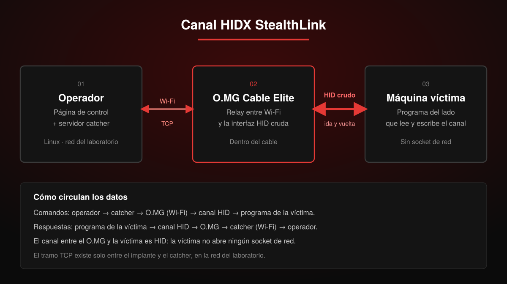
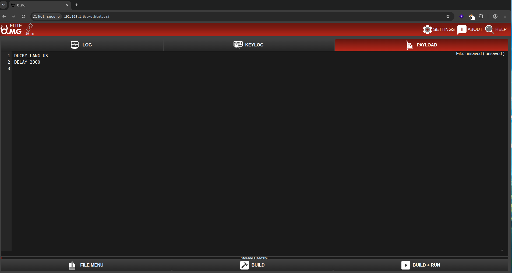
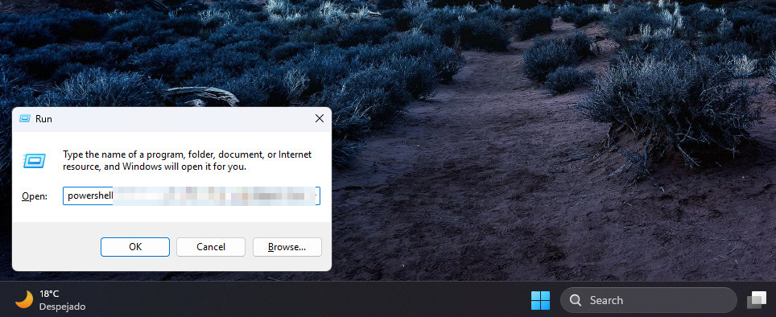

# O.MG Cable y HIDX StealthLink

En este artículo vamos a ver cómo el **O.MG Cable**, mediante **HIDX StealthLink**, lleva la inyección de teclado tradicional a un nivel completamente distinto.

**HIDX StealthLink** es una de las capacidades más interesantes del O.MG Cable Elite. Permite establecer un canal de comunicación bidireccional entre el equipo objetivo y la estación de control mediante una interfaz USB HID, utilizando el implante como intermediario entre el host y la red inalámbrica del operador.

Pero antes de profundizar con la función, arranquemos por algo más básico. Qué es el O.MG Cable y qué riesgos implica?

<!-- more -->

## El cable es el implante

La mayoría conoce los vectores de acceso inicial basados en software, como la explotación de vulnerabilidades o los ataques de phishing. Estas técnicas pueden permitir la ejecución de código, el acceso a información o el establecimiento de un punto de apoyo desde el cual realizar otras acciones.

El O.MG Cable introduce un enfoque diferente. Utiliza un dispositivo físico de apariencia legítima para interactuar con el sistema objetivo. En lugar de depender necesariamente de la explotación de una vulnerabilidad de software, aprovecha la confianza que el sistema operativo deposita en determinados periféricos USB.


El O.MG Cable, fabricado por [MG](https://mg.lol/) y comercializado por [Hak5](https://shop.hak5.org/products/omg-cable), se ve y funciona exactamente igual que cualquier cable USB-C, Lightning o USB-A común. Sin embargo, dentro del conector esconde una placa diminuta equipada con un chip, antena Wi-Fi propia, memoria y una interfaz de control web a la que el operador accede desde el navegador. La máquina de la víctima lo reconoce automáticamente como un periférico de entrada estándar, mientras que el atacante mantiene el control a distancia.

El O.MG Cable se comercializa en versiones Basic y Elite. Estas son las diferencias técnicas principales entre ambas generaciones:

| Función (generación de hardware) | Basic (Gen 1) | Elite (Gen 3) |
| --- | --- | --- |
| Inyección de teclado | DuckyScript 2 | DuckyScript 3 |
| Inyección de mouse | Sí | Sí |
| Slots de payloads | 8 | 50-300 |
| Tamaño máx. de payload | 4.000 pulsaciones | 1.500.000 pulsaciones |
| Velocidad máx. | 120 puls./seg | 890 puls./seg |
| Autodestrucción | Sí | Sí |
| Geofencing | Sí | Sí |
| Disparadores por Wi-Fi | Sí | Sí |
| Keylogger de hardware USB FullSpeed | No | Sí |
| HIDX StealthLink | No | Sí |
| C2 de red cifrado | No | Sí |
| Alcance Wi-Fi extendido | No | Sí |
| Consumo optimizado para sigilo | No | Sí |

*Todas las especificaciones corresponden al firmware beta más reciente.*

Entre sus capacidades operativas destacan:

- **Control Wi-Fi**: gestión integral desde el navegador, ya sea desde un equipo de escritorio o dispositivo móvil.
- **Keymaps globales**: incluye 192 distribuciones de teclado para adaptarse a configuraciones regionales de cualquier país.
- **IDE integrado**: la WebUI marca errores de sintaxis en tiempo real mientras se desarrollan los payloads.
- **Payloads a móviles**: los modelos con punta activa USB-C permiten interactuar directamente con dispositivos móviles.
- **Sigilo**: permanece en reposo hasta recibir el disparador; emula un dispositivo USB 2.0 convencional y permite falsear identificadores USB (VID/PID) y direcciones MAC de red.
- **Keylogger de hardware** (Elite): captura pasiva de tráfico para teclados USB FullSpeed con capacidad de almacenamiento de hasta 650.000 pulsaciones.
- **HIDX StealthLink** (Elite): túnel bidireccional entre el host objetivo, el O.MG y la estación de control.
- **C2 de red cifrado** (Elite): canal de comando y control cifrado, con la opción de desactivar la WebUI para operar de forma oculta en entornos hostiles.
- **Autodestrucción**: borra de forma segura payloads y registros internos, dejando el dispositivo inerte (recuperable mediante el O.MG Programmer).
- **Geofencing**: automatiza acciones basadas en ubicación geográfica (por ejemplo, autoinmolación si el cable sale de un radio determinado).
- **Disparadores por Wi-Fi**: ejecución remota de scripts mediante balizas Wi-Fi específicas.


El principal riesgo no está solamente en que el cable pase desapercibido, sino en la **confianza** que los sistemas operativos depositan en los dispositivos USB conectados. Un cable olvidado en una sala de reuniones o intercambiado en un espacio de trabajo comparte ciertos objetivos con un correo de phishing, como lograr la ejecución de código inicial, pero utiliza un modelo completamente diferente. Opera mediante requisitos, restricciones y capacidades físicas particulares que evitan filtros de correo, aunque su éxito efectivo dependerá de la configuración del dispositivo, el contexto del equipo objetivo y los controles de seguridad perimetrales o de endpoint vigentes.

## Del software al hardware. Cómo un cable puede ejecutar comandos

Este comportamiento se sustenta en la forma en que los sistemas operativos gestionan los periféricos de entrada.

Al conectar un dispositivo USB, este se enumera declarando su clase al host. Si se presenta como un teclado (dispositivo HID), en configuraciones habituales, el sistema puede reconocerlo y habilitarlo automáticamente mediante controladores nativos, siempre que las políticas de seguridad lo permitan, priorizando su operatividad ante cualquier otra tarea. El implante del O.MG explota este comportamiento predeterminado inyectando comandos a alta velocidad, simulando la escritura humana.

Aunque este principio es compartido con herramientas clásicas como el Rubber Ducky, la inyección tradicional sufre de una limitación operativa crítica, es estrictamente **unidireccional y a ciegas**. El dispositivo escribe comandos pero no recibe retroalimentación sobre su éxito o fallo (por ejemplo, si una ventana emergente de UAC o un bloqueo de pantalla interfirieron), dejando al operador sin visibilidad en tiempo real.

El O.MG supera esta restricción integrando componentes avanzados.

- **Conectividad Wi-Fi y motor web**, permitiendo parametrizar y disparar secuencias de forma remota.
- **Memoria y lógica de ejecución condicional**, capaces de albergar múltiples escenarios de ataque.
- **Microcontrolador programable**, clave para habilitar un canal de comunicación bidireccional.

Gracias a su conectividad Wi-Fi y capacidad de procesamiento, el O.MG puede ir más allá de la inyección de comandos y habilitar la exfiltración de datos y comunicaciones interactivas con el equipo objetivo.

## HIDX StealthLink: ¿qué es?

StealthLink es la función del O.MG Cable Elite que habilita un canal de comunicación bidireccional entre el implante y el operador, permitiendo enviar instrucciones y recibir respuestas en tiempo real.

Este canal se establece a través de una interfaz HID (*Human Interface Device*) cruda expuesta por el implante en el sistema operativo víctima. No constituye una interfaz de red ni un almacenamiento externo, sino que reutiliza la arquitectura de los dispositivos de entrada para transportar datos en ambos sentidos.

- El implante expone una interfaz HID dedicada de forma independiente al canal de inyección de teclado convencional.
- Un agente liviano ejecutado en la máquina víctima (mediante scripts en PowerShell o Python) interactúa con dicha interfaz para leer y escribir tramas de datos hacia el implante.

El implante actúa como pasarela entre el entorno del atacante y el equipo comprometido, ofreciendo un canal de transferencia acotado pero suficiente para operar de forma interactiva.



El concepto de sigilo (*stealth*) se apoya en los siguientes factores operativos.

- **Aislamiento del canal en el host**, la máquina víctima no levanta servicios de red ni genera conexiones salientes hacia internet o la red local a través de su propia pila IP para este canal, lo que reduce la visibilidad ante herramientas tradicionales de monitoreo de red basadas en host. Sin embargo, **debe tenerse en cuenta que el cable O.MG en sí mismo genera tráfico de red mediante su propia interfaz Wi-Fi** al comunicarse con el servidor catcher del operador.
- **Minimización de artefactos locales**, la ejecución en el host se apoya en controladores nativos del sistema operativo para dispositivos HID, evitando la instalación de drivers propietarios, aunque la ejecución de intérpretes (como PowerShell) puede registrar entradas en los logs del sistema.
- **Mimetización con el tráfico legítimo**, el uso constante de periféricos HID en entornos corporativos reduce la probabilidad de que este canal genere anomalías evidentes ante soluciones de monitoreo genéricas, aunque un EDR configurado estrictamente puede llegar a advertir comportamientos anómalos en el acceso a interfaces HID o procesos asociados.

### **Limitaciones operativas**

El rendimiento del sistema está condicionado por los siguientes factores.

- **Ancho de banda limitado**, al tunelizar datos por una interfaz HID, la tasa de transferencia es baja, por lo que no resulta apto para la exfiltración masiva de archivos pesados.
- **Dependencia del entorno**, requiere permisos de ejecución adecuados en el host para inicializar el script cliente, compatibilidad con la versión del firmware y estabilidad en la conexión inalámbrica del implante.
- **Conectividad del implante**, permite establecer comunicaciones con sistemas air-gapped sin utilizar la interfaz de red del equipo objetivo. Para operar remotamente, el implante debe disponer de un enlace inalámbrico con la infraestructura o estación de control, ya sea mediante su propio punto de acceso Wi-Fi (modo AP) o conectándose a una red existente (modo Station). No requiere necesariamente acceso a Internet ni infraestructura inalámbrica externa. Determinadas operaciones también permiten almacenar información localmente en el dispositivo.

## Armado del laboratorio

El escenario de pruebas consta de tres componentes principales: una máquina Linux que aloja el servidor receptor (*catcher*), una máquina Windows que cumple el rol de víctima, y el O.MG Cable interconectado físicamente por USB.


## Configuración del O.MG

Se requiere un O.MG Cable Elite con firmware v3 o superior compatible con HIDX StealthLink, actualizado mediante la herramienta oficial [WebFlasher](https://o-mg.github.io/WebFlasher/).

### **Configuración HIDX (pestaña USB)**

1. Acceder a la interfaz de configuración mediante el icono de engranaje.
2. Seleccionar la pestaña **USB**.
3. Habilitar **HIDX TCP** para permitir que el implante establezca una conexión TCP saliente hacia el servidor receptor.
4. Indicar la dirección IP de la máquina Linux en **HIDX Server Address** (`192.168.1.5`) y el puerto del servidor en **HIDX Server Port** (`1234`).
5. Activar **HIDX AutoStart on Boot** para automatizar el inicio del túnel al energizarse el dispositivo.
6. Guardar los cambios presionando **CHANGE SETTINGS**.


### **Configuración de red (pestaña NET)**

1. Abrir el menú de configuración.
2. Seleccionar la pestaña **NET**.
3. Configurar **WiFi Mode** en modo **Station** para que el implante se conecte a una red inalámbrica existente en lugar de generar un punto de acceso propio.
4. Introducir el SSID y la contraseña de la red del laboratorio.
5. Aplicar los cambios mediante **CHANGE SETTINGS** para reiniciar el implante y verificar la dirección IP asignada en **Device IP Address** (`192.168.1.6`).




*Nota: Los pasos exactos de configuración pueden variar según la versión del firmware, se aconseja consultar la documentación oficial en el repositorio [HIDX StealthLink Wiki - Windows PowerShell](https://github.com/O-MG/O.MG-Firmware/wiki/HIDX-StealthLink---Windows-PowerShell---Shell).*

## Demostración

### **Carga del payload**

Desde la consola web del O.MG, seleccionar el payload StealthLink correspondiente a Windows/PowerShell y transferirlo a la memoria del dispositivo.


### **Puesta en marcha del receptor y ejecución**

Iniciar el servidor receptor en la máquina Linux:

```bash
python3 stealthlink-client-universal.py 0.0.0.0 1234
[*]Server listening on 0.0.0.0:1234
```
La ejecución se inicia desde la interfaz web de control. El payload abre el cuadro de diálogo **Ejecutar** de Windows e introduce el comando mediante emulación HID, dejándolo escrito en el campo correspondiente antes de confirmar su ejecución.


En esta demostración, el payload descarga y ejecuta `win-hidshell.ps1` mediante PowerShell, utilizando la conectividad IP de Windows. Una vez iniciado, StealthLink intercambia comandos y respuestas a través de USB HID, mientras que el O.MG Cable utiliza su propia conexión Wi-Fi para comunicarse con el receptor Linux, sin depender de la interfaz de red del host.

Establecimiento de sesión

Una vez ejecutado el agente en el host víctima, el implante abre el canal TCP contra el catcher. En el host Linux.

```
[*]Server listening on 0.0.0.0:1234
[+]O.MG Device connected from 192.168.1.6:2742
HIDX StealthLink Universal Client (type '%quit' to exit)
[+]Session Established!
>
```
Operación

A través de la consola interactiva establecida mediante el canal HID, es posible ejecutar comandos en el sistema objetivo y recibir sus resultados, dentro de los permisos correspondientes al contexto de ejecución del cliente.
```
[+]Session Established!
>
whoami
b0nyo-pc\bonyo
```

## PoC

<video controls muted playsinline preload="metadata" width="100%">
  <source src="/assets/video/poc_omg.mp4" type="video/mp4">
  Tu navegador no soporta la reproducción de video.
</video>

Aunque el video corresponde a una demostración anterior, la PoC se ejecutó nuevamente con éxito el 16 de noviembre de 2026.

Durante la prueba el Microsoft Defender Antivirus se encontraba activo con las siguientes configuraciones.

Detalle del AV y OS


## Detección y defensa

El principal desafío defensivo de HIDX StealthLink es que su canal de comunicación no utiliza la pila de red del equipo objetivo. Los comandos y sus respuestas se transportan mediante USB HID, mientras que el implante establece una conexión inalámbrica independiente con la estación de control.

Esto limita la visibilidad de los controles tradicionales de inspección de tráfico IP del host, como NIDS y políticas de *egress filtering*. Sin embargo, no implica que la actividad sea indetectable, ya que la ejecución del cliente y su interacción con el sistema operativo pueden generar evidencias.

Las principales superficies de detección y mitigación son las siguientes.

- **Seguridad física.** Controlar la procedencia de cables y periféricos USB. La inspección visual no garantiza la identificación de implantes integrados en dispositivos de apariencia legítima.

- **Auditoría USB e HID.** Supervisar la enumeración de nuevos dispositivos, cambios inesperados en interfaces HID y accesos a dispositivos mediante *raw HID*. Los reportes bidireccionales pueden aportar contexto, aunque no constituyen por sí solos un indicador de actividad maliciosa.

- **Telemetría del endpoint.** Correlacionar eventos de conexión USB con la creación de procesos y la ejecución de scripts. En Windows, Script Block Logging permite registrar bloques de PowerShell mediante el Event ID 4104 cuando está habilitado. La detección de comportamientos asociados con HID depende de las capacidades y la configuración del EDR.

- **Control de dispositivos.** Aplicar restricciones de instalación de periféricos mediante políticas corporativas, utilizando identificadores de hardware, clases e identificadores de instancia. Las listas de dispositivos autorizados reducen la exposición, aunque los identificadores VID/PID pueden ser suplantados.

Estas medidas deben complementarse con controles de acceso físico y bloqueo automático de sesiones, especialmente en estaciones de trabajo sensibles.

## Conclusión

El O.MG Cable aprovecha la confianza que los sistemas operativos depositan en los periféricos HID para introducir comandos mediante emulación de teclado. HIDX StealthLink amplía esta capacidad incorporando un canal bidireccional que permite intercambiar instrucciones y respuestas sin utilizar la interfaz de red convencional del equipo objetivo para ese transporte.

Durante la PoC se estableció una sesión interactiva funcional y se ejecutaron comandos remotamente sobre Windows. Aunque el equipo contaba con conectividad Ethernet para la carga inicial del cliente, la comunicación interactiva de StealthLink se realizó mediante USB HID y la conexión Wi-Fi del implante.

La demostración confirma el funcionamiento del mecanismo, pero no constituye una prueba de evasión de Microsoft Defender ni de otros controles de seguridad, dado que no se realizó un análisis específico de su telemetría.

Desde el lado defensivo, esta prueba también deja algo claro. No alcanza con monitorear el tráfico de red. Hay que tener visibilidad sobre los dispositivos USB, los procesos que se ejecutan y la actividad del endpoint.

## Fuentes

- [O.MG Firmware Wiki](https://github.com/O-MG/O.MG-Firmware/wiki)
- [HIDX StealthLink - Windows PowerShell Shell](https://github.com/O-MG/O.MG-Firmware/wiki/HIDX-StealthLink---Windows-PowerShell---Shell)
- [O.MG Cable - Hak5](https://shop.hak5.org/products/omg-cable)
- [Microsoft - PowerShell Logging](https://learn.microsoft.com/en-us/powershell/module/microsoft.powershell.core/about/about_logging)
- [Microsoft - Device Installation Restrictions](https://learn.microsoft.com/en-us/windows/client-management/client-tools/manage-device-installation-with-group-policy)

## Aviso legal

Este artículo tiene fines educativos y de investigación en ciberseguridad. El O.MG Cable es una herramienta comercial de pruebas de seguridad cuyas capacidades están documentadas públicamente por su fabricante.

Las pruebas deben realizarse exclusivamente sobre sistemas propios o con autorización expresa, dentro de entornos controlados. Su utilización sin autorización puede infringir la legislación aplicable.
